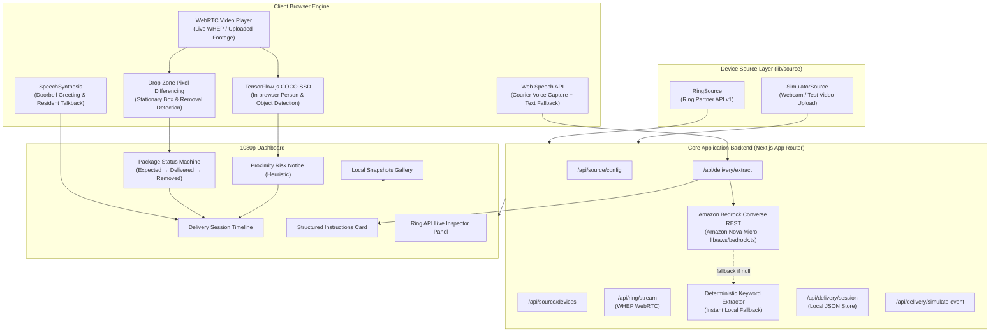

# Smart Delivery Assistant for Ring

[](https://nextjs.org/)
[](https://www.typescriptlang.org/)
[](https://developer.amazon.com/docs/ring/api-documentation.html)
[](LICENSE)

An intelligent delivery interaction and package protection system built on top of the **Amazon Ring Partner API**. Developed as an entry for the **"Build, Ship, Shape: Amazon Developer Hackathon" (Ring Track)**.

The assistant handles courier doorstep voice communication, automatically extracts structured drop-off instructions, establishes a calibrated drop zone, and monitors package status in real-time — linking doorbell ringing, greeting, instructions, package status (`Expected` &rarr; `Delivered` &rarr; `Removed`), and heuristic proximity alerts into a single cohesive delivery timeline.

---

## 🏗 Architecture



---

## ⚡ Key Features

### 1. Delivery Assistant & Two-Way Interaction
- **Automated Audio Greeting**: Speaks *"Hi, please leave the package or tell me where you left it."* via browser `speechSynthesis` when the doorbell rings.
- **Courier Voice Capture**: Transcribes courier speech using the browser Web Speech API (`SpeechRecognition`) with an instant typed-text fallback for non-mic environments.
- **Structured Instruction Extraction**:
  - **Amazon Bedrock (Amazon Nova Micro)**: Server-side REST integration with the Bedrock Converse API (`https://bedrock-runtime.{region}.amazonaws.com/model/{modelId}/converse`) using direct native `fetch` (zero AWS SDK footprint). Activated via `LLM_EXTRACTION=on`.
  - **Graceful Fallback**: If Bedrock is unconfigured, times out, or fails, automatically falls back to the deterministic local keyword/rule extractor.
  - **Strict Privacy**: Only courier transcript text is sent; environment variables and API tokens are never exposed to the browser or logged.
  - **UI Engine Status**: Real-time indicator in the UI displays `AWS Bedrock (Amazon Nova): on` or `fallback`.
  - Parsed fields: `location` (e.g. *Behind planter / pot*, *Front door*), `action` (`left` | `hold` | `handed_over`), `needs_signature` (`true` | `false`), and `notes`.
- **Accessibility Resident Talkback**: Displays live captions on screen and allows residents to type messages that are spoken aloud to the courier.

### 2. Package Watch & Drop Zone Differencing
- **Drop-Zone Calibration**: User-adjustable drop zone with auto-calibration from baseline frames.
- **Edge Margin Exclusion**: Frame border margins (top/bottom/left/right 6–8%) are masked out to eliminate false positives from camera watermarks, timestamps, or device identifiers.
- **Tunable Sensitivity Slider**: Adjust difference sensitivity (10–60, default 26).
- **Package State Machine**: Transitions cleanly between `Expected` &rarr; `Delivered` &rarr; `Removed`.
- **Automatic Snapshots**: Captures canvas snapshots locally when status changes occur.

### 3. Suspicious Proximity Activity Alert
- Detects if a person enters or overlaps the drop zone while a package is present (`Delivered`).
- Displays the exact compliant notification:
  > *"Possible risk: a person approached the package at &lt;time&gt;."*
- Prominent compliance disclaimer:
  > *"Heuristic alert, not proof of intent. No facial recognition or identity tracking."*
- **Strict Compliance**: The word *"theft"* is never used in the UI or alert notifications.

### 4. Zero-Dependency "Run Demo Scenario"
- A dedicated **"🎬 Run Demo Scenario"** button scripts the entire end-to-end lifecycle:
  1. Doorbell chime received &rarr; Timeline updated
  2. Greeting spoken aloud
  3. Canned courier reply transcribed & parsed into structured instructions
  4. Package status verified &rarr; `Delivered (package present)`
  5. Person approaches drop zone &rarr; Proximity notice triggered
  6. Box removed &rarr; Status updated to `Removed` with local snapshot captured
- **Runs seamlessly on any machine** without requiring a camera, microphone, or Ring token!

---

## 🔌 Ring Partner API Usage

This codebase directly interfaces with the Ring Partner API (`https://api.amazonvision.com/v1`):

| Endpoint | Method | Implementation File | Usage in Project |
|---|:---:|---|---|
| `/v1/devices` | `GET` | [`lib/source/ring-source.ts`](file:///d:/hackathon/amazon_buid/ring-api-helloworld/lib/source/ring-source.ts) | Auto-discovers linked Ring doorbells and cameras. |
| `/v1/devices/{id}/status` | `GET` | [`app/api/source/devices/[id]/status/route.ts`](file:///d:/hackathon/amazon_buid/ring-api-helloworld/app/api/source/devices/[id]/status/route.ts) | Reads device online status, battery level, and health. |
| `/v1/devices/{id}/capabilities` | `GET` | [`scripts/device_capabilities.py`](file:///d:/hackathon/amazon_buid/ring-api-helloworld/scripts/device_capabilities.py) | Inspects video codecs, resolution, and motion zone capabilities. |
| `/v1/history/devices/{id}/events` | `GET` | [`app/api/ring/events/history/route.ts`](file:///d:/hackathon/amazon_buid/ring-api-helloworld/app/api/ring/events/history/route.ts) | Fetches past motion, ding, and live-view events for the Ring Data Panel. |
| `/v1/devices/{id}/media/streaming/whep/sessions` | `POST` | [`app/api/ring/stream/route.ts`](file:///d:/hackathon/amazon_buid/ring-api-helloworld/app/api/ring/stream/route.ts) | Negotiates WHEP SDP offer/answer to establish low-latency WebRTC live stream. |
| `/v1/devices/{id}/media/streaming/whep/sessions/{id}` | `DELETE` | [`app/api/ring/stream/route.ts`](file:///d:/hackathon/amazon_buid/ring-api-helloworld/app/api/ring/stream/route.ts) | Closes WHEP streaming session cleanly on stop or timeout. |

---

## 🕹 The Two Source Modes

Set `SOURCE_MODE` in `.env.local` to switch between modes:

### 1. `SOURCE_MODE=ring`
- **Badge**: `Ring API (Playground simulated stream)`
- Connects to the real **Ring Partner API** using your Playground access token.
- Displays the **Ring Partner API Data** inspector showing live connected devices, online status, battery health, and recent event history.
- Streams live video via WHEP WebRTC.
- Automatically handles Playground 30–60 second session limits with a one-click **"Restart Live Stream"** button.

### 2. `SOURCE_MODE=simulator` *(Default)*
- **Badge**: `Simulator (test footage)`
- Fully offline and standalone — no tokens or Ring hardware required.
- Supports **video file upload** (with play/pause/loop controls) to test on custom parcel footage, live webcam, or an animated synthetic porch camera.
- Full `Expected` &rarr; `Delivered` &rarr; `Removed` delivery flow.

---

## 🔒 Privacy, Security & Ethics

- **Local Video Processing**: All computer vision, COCO-SSD object detection, and drop-zone pixel differencing run entirely inside the client's browser. Video streams and snapshots are never uploaded to any third-party cloud server.
- **Audio & Speech**: Audio is processed using the browser's built-in Web Speech API service. Video and snapshots stay strictly local.
- **No Facial Recognition or Identity Tracking**: The system does not perform facial recognition, gender/age estimation, or identity inference.
- **Heuristic Notice**: Bounding box overlap is treated strictly as a geometric proximity heuristic, never as proof of intent or characterization of theft.

---

## 🚀 Getting Started

### 1. Installation

```bash
cd ring-api-helloworld
npm install
```

### 2. Environment Configuration

Copy the example configuration:
```bash
cp .env.example .env.local
```

Configure your desired mode in `.env.local`:

```env
# Mode 1: Simulator (Default - no token needed)
SOURCE_MODE=simulator

# Mode 2: Ring Partner API
# SOURCE_MODE=ring
# RING_ACCESS_TOKEN=eyJhbGciOiJSUzI1Ni... (Paste from Ring Developer Playground)
# NEXT_PUBLIC_RING_DEVICE_ID=ava1.ring.device.XXX
```

### 3. Run Development Server

```bash
npm run dev
```

Open [http://localhost:3000](http://localhost:3000) in Google Chrome or Microsoft Edge.

### 4. Build for Production

```bash
npx tsc --noEmit
npm run build
```

---

## 🎬 Testing in 3 Steps

1. Click **"🎬 Run Demo Scenario"** on the top toolbar to watch the full automated workflow (doorbell &rarr; greeting &rarr; courier reply &rarr; structured instructions &rarr; package status &rarr; proximity alert &rarr; removal snapshot).
2. Click **"🔔 Simulate Doorbell"**, listen to the automated greeting, click **"🎤 Listen (Mic)"** (or type in the box), and click **"Process Instructions →"**.
3. In Ring mode, click **"▶ Start Live Stream"** to watch the Ring Playground WHEP video with live drop-zone tracking.

---

## 📚 Attributions & Credits

- Based on and extended from [AmazonAppDev/ring-api-helloworld](https://github.com/AmazonAppDev/ring-api-helloworld).
- Ring Playground simulated streams are licensed under Creative Commons Attribution 4.0 International ([CC BY 4.0](https://creativecommons.org/licenses/by/4.0/)):
  - *"Thief stealing our package"* by YouTube user **frollard** (Porch & Package stream)
  - *"Birds on Feeders"* by Vimeo user **Michael Black** (Motion stream)
- Object detection powered by [TensorFlow.js COCO-SSD](https://github.com/tensorflow/tfjs-models/tree/master/coco-ssd).

---

## 📄 License

This project is licensed under the [MIT License](LICENSE).
