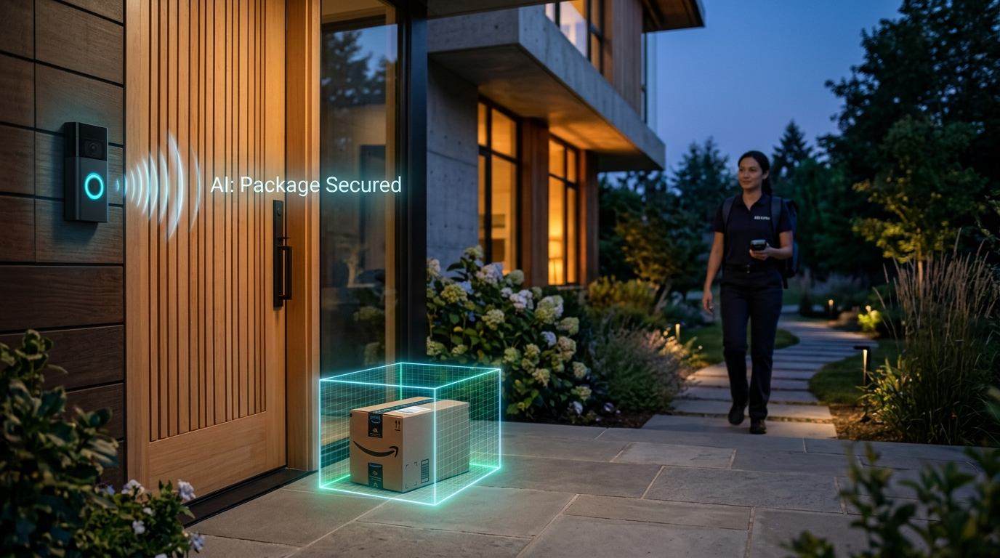
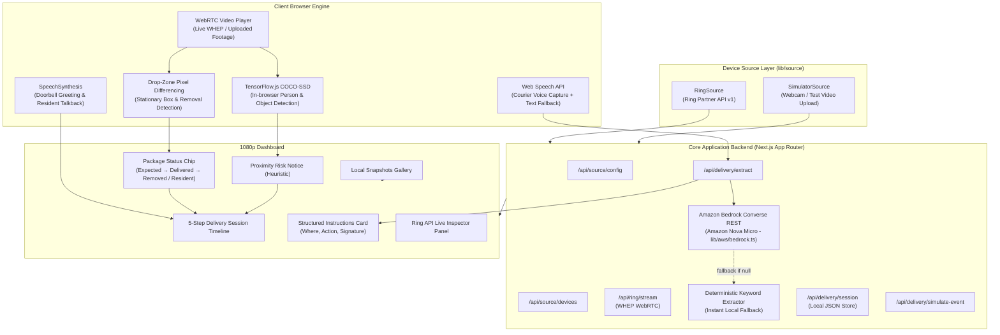

# Smart Delivery Assistant for Ring

[](https://nextjs.org/)
[](https://www.typescriptlang.org/)
[](https://developer.amazon.com/docs/ring/api-documentation.html)
[](https://aws.amazon.com/bedrock/)
[](LICENSE)



> **"Talks to the courier, remembers the delivery instructions, and warns you if someone approaches your package."**

An intelligent doorstep delivery assistant and package watch system built on top of the **Amazon Ring Partner API** and **Amazon Bedrock**. Developed as an entry for the **"Build, Ship, Shape: Amazon Developer Hackathon" (Ring Track & AWS Builder Mini-Challenge)**.

---

## 🎥 Demo

[▶ Watch the demo video (under 3 minutes)](YOUR_VIDEO_LINK)

<!-- Add screenshots here: dashboard overview, delivery timeline, Ring API data panel -->

---

## 🙋 Who It Helps

- **Residents who miss deliveries**: Couriers get a spoken greeting and their reply is saved as clear instructions, so you know where the package is.
- **Deaf or hard-of-hearing residents**: The courier's reply appears as live captions, and the resident can type a reply that is spoken aloud to the courier.
- **Small businesses and shared buildings**: A simple record of when a package was delivered, where it was left, and when it was removed.

This project uses Ring's package/delivery management and accessibility use cases rather than a plain motion alert.

**Path toward a real product:** The Ring developer docs describe OAuth account linking, webhook event delivery, and a certification step before publishing to the Ring Appstore. This project currently runs against the developer Playground token and simulated streams, and it is not Ring-certified. The design choices here (local video processing, no face recognition, no identity inference, alerts worded as heuristics) are intended to be conservative, and Ring's Computer Vision Guidelines should be reviewed before any real-world release.

---

## 🏗 Architecture



---

## 🆕 What's New vs. the Starter

This project started from [AmazonAppDev/ring-api-helloworld](https://github.com/AmazonAppDev/ring-api-helloworld) (MIT). 

**Provided by the starter:** Ring token handling (`lib/auth.ts`), the WHEP live-stream route (`app/api/ring/stream`), the webhook receiver with SSE, the video-processor plugin system, and the Python API scripts in `scripts/`.

**Added in this project:**

| Area | What was built |
|------|----------------|
| **Device source layer** | `lib/source/` with a `RingSource` (Ring Partner API) and a `SimulatorSource` (webcam / uploaded video), switched by `SOURCE_MODE` |
| **Delivery Assistant** | Doorbell flow, spoken greeting, courier voice capture with typed fallback, live captions, resident talk-back |
| **Instruction extraction** | `lib/delivery/extractor.ts` (keyword extractor + fallback logic) and `lib/aws/bedrock.ts` (Amazon Bedrock, Amazon Nova Micro) |
| **Package Watch** | Adjustable drop zone, baseline calibration, edge-margin masking, frame differencing, in-browser COCO-SSD person detection, `Expected → Delivered → Removed` status, local snapshots |
| **Delivery verification** | ~20s timer when courier says *"left"*: confirms drop-zone presence (`info`) or issues notice (`warning`) |
| **Proximity notice** | Heuristic "possible risk" notice when a person overlaps the drop zone after delivery, with 10s grace period and resident self-declaration ("🙋 It's me") |
| **Session timeline** | Delivery timeline and local JSON session store (`lib/store.ts`) |
| **Ring data panel** | Device list, status and event history (`lib/source/ring-source.ts`, `app/api/source/devices/[id]/status/route.ts`, `app/api/ring/events/history/route.ts`) |
| **Busy Mode (/visitor)** | Automated visitor assistant answering the door on 3 rings: relays custom instructions, captures messages, and escalates emergencies |
| **Demo tooling** | "Run Demo Scenario" button (no camera, mic or token needed) and a simulator mode with video upload |

---

## ☁️ AWS Builder: Amazon Bedrock

**Service:** Amazon Bedrock (Converse API) with **Amazon Nova Micro** (`amazon.nova-micro-v1:0`), called from [`lib/aws/bedrock.ts`](lib/aws/bedrock.ts).

**What it does:**
1. **Courier Instruction Extraction**: Turns informal courier speech into structured delivery data (`location`, `action`, `needs_signature`, `notes`), e.g., *"I left it behind the flower pots, no signature needed"* becomes a clean record shown on the timeline.
2. **Busy Mode Visitor Understanding**: In Busy Mode (`/visitor`), classifies visitor speech into `message`, `emergency`, or `other`, and crafts polite, context-aware 1–2 sentence replies strictly honoring owner instructions without hallucinating.

**How it is integrated:**
- Server-side only, using a plain native `fetch` to the Bedrock Runtime Converse endpoint with a Bedrock API key (`AWS_BEARER_TOKEN_BEDROCK`). Zero AWS SDK bloat.
- Enabled with `LLM_EXTRACTION=on`. Output is strictly validated with Zod and bounded by a 7-second abort timeout.
- **Dual-Layer Fallback**: If Bedrock is unconfigured, times out, or returns invalid data, the app falls back seamlessly to deterministic local keyword templates. The UI dynamically displays `AI: Bedrock (Nova)` vs `AI: Fallback`.
- **Strict Privacy**: **Only transcript text is sent to AWS.** Camera video, frames, snapshots, and visitor biometrics never leave the machine. Keys and transcripts are never logged.
- Tested with `AWS_REGION=ap-south-1`. Compatible with any AWS region where Nova Micro is enabled.

```env
LLM_EXTRACTION=on
AWS_BEARER_TOKEN_BEDROCK=your_bedrock_api_key
AWS_REGION=ap-south-1
BEDROCK_MODEL_ID=amazon.nova-micro-v1:0
```

---

## ⚡ Key Features

### 1. Delivery Assistant & Multimodal Voice Flow
- **Automated Doorbell Greeting**: Speaks *"Hi! Please leave the package or tell me where you left it."* via browser `speechSynthesis` when the doorbell rings.
- **Voice-to-Text Courier Capture**: Captures speech using the browser's Web Speech API (`SpeechRecognition`) with an immediate typed fallback.
- **Structured Instruction Extraction**: Extracts drop location (e.g. *Behind planter by front door*), action (`left`, `hold`, `handed_over`), signature requirements, and safety notes.
- **Resident Talkback & Live Captions**: Live transcription with bidirectional text-to-speech talkback.

### 2. Package Watch & Drop Zone Differencing
- **Interactive Drop Zone**: User-adjustable bounding box positioned over doorstep steps or porch drop areas.
- **Edge Margin Exclusion**: Frame edges (6–8% margin) are automatically excluded to ignore camera watermarks, timestamps, and device labels.
- **Baseline Calibration**: Automatically calibrates from the first 30 frames (with manual **"Calibrate Baseline"** button and sensitivity threshold slider).
- **Package Status Progression**: Seamless lifecycle tracking (`Expected` &rarr; `Delivered` &rarr; `Removed`).

### 3. Verification & Proximity Alert Logic
- **Delivery Verification (~20s Window)**: When courier instructions indicate `action=left`, an automated timer monitors the drop zone. Confirms package presence (`info`) or flags an actionable alert (`warning`) if unconfirmed.
- **Grace Period**: Ignores people for the first 10 seconds following status `Delivered` to allow couriers to walk away cleanly.
- **Sustained Overlap (2–3 seconds)**: Requires 20+ frames of continuous overlap before alerting.
- **Compliant Wording**: Uses exact phrasing:
  > *"Possible risk: a person approached the package at &lt;time&gt;."*
- **Compliance Disclaimer**:
  > *"Heuristic alert, not proof of intent. No facial recognition or identity tracking."*
- **"🙋 It's me" Self-Declaration**: Residents can declare they retrieved their package, clearing active alerts and updating status to *"Picked up by resident"*. The word *"theft"* is never used.

### 4. Zero-Dependency "Run Demo Scenario"
Clicking **"🎬 Run Demo Scenario"** executes the complete visual timeline:
1. Initializes synthetic porch camera feed.
2. Doorbell chime received & timeline updated.
3. Automated voice greeting spoken aloud.
4. Courier reply captured & structured instructions parsed.
5. Box appears & drop zone confirms delivery (`info`).
6. Person approaches drop zone & proximity notice triggers (`risk`).
7. Package taken & status updates to `Removed` with local canvas snapshot.

---

## 🚪 Busy Mode Visitor Assistant (`/visitor`)

Accessible via the **"🚪 Busy Mode"** button in the dashboard header.

When the homeowner is busy, in a meeting, or away, the assistant takes over doorstep interactions on their behalf:
- **🔔 Realistic Two-Tone Doorbell Chime ([`lib/sound.ts`](lib/sound.ts))**:
  - Synthesizes a classic Westminster-style "Ding-Dong" chime using the browser's native **Web Audio API** (830 Hz &rarr; 622 Hz with acoustic exponential decay).
  - Requires **zero external audio files or downloads** — generated instantly in pure client-side code on every doorbell button press and demo chime.
- **3-Ring Trigger (10-Second Window)**: When a visitor rings 3 times within 10 seconds, the assistant activates. (The counter automatically resets after 10 seconds idle).
  > *Note on simulation:* The triple ring is simulated in software because the Ring Developer Playground does not emit live doorbell-press events. In a production Appstore release, this binds directly to the Ring `ding` webhook event.
- **🎙️ Real-Time Hardware Audio Level Visualizer**:
  - Clicking the microphone activates an active Web Audio decibel meter (`Audio Level: [████████░░░░] 68%`) powered by an `AnalyserNode`.
  - Gives visitors and judges immediate visual confirmation that their microphone is capturing live soundwaves.
- **💬 One-Click Quick Speech Presets**:
  - Includes instant one-click visitor speech buttons (*"I have a package to deliver for you"*, *"Please tell the owner David stopped by"*, *"Help! There is an emergency at the door!"*) and courier presets.
  - Allows full end-to-end testing of voice conversations without needing microphone hardware or an active internet speech connection.
- **Automated Identity & Ethics**:
  - The assistant explicitly introduces itself as an automated doorbell assistant.
  - It never pretends to be the homeowner, never shares personal details, and never offers to unlock or open the door.
- **Relays Owner Instructions**: Accurately speaks only what the owner configured in their notes (with quick-select presets like *"Busy until evening"*, *"Leave packages at the gate"*, or *"No visitors today"*).
- **Visitor Message & Emergency Classification**:
  - **Normal Message**: Transcribed and saved directly to the owner's phone mock list with timestamps.
  - **Emergency Escalation**: Keyword safety net + AI classifier immediately triggers high-priority red phone alerts, browser notifications, and advises the visitor to call 112 if anyone is in danger.
  - **Optional Telegram Push**: Set `TELEGRAM_BOT_TOKEN` and `TELEGRAM_CHAT_ID` in `.env.local` to receive doorstep emergency alerts directly on your mobile device.
- **Privacy First**: Only transcript text is sent to Amazon Bedrock (Nova Micro). Camera video, snapshots, and visitor biometrics never leave the local browser.

---

## 🔌 Ring Partner API Usage

This codebase directly interfaces with the Ring Partner API (`https://api.amazonvision.com/v1`):

| Endpoint | Method | Implementation File | Usage in Project |
|---|:---:|---|---|
| `/v1/devices` | `GET` | [`lib/source/ring-source.ts`](lib/source/ring-source.ts) | Auto-discovers linked Ring doorbells and cameras. |
| `/v1/devices/{id}/status` | `GET` | [`app/api/source/devices/[id]/status/route.ts`](app/api/source/devices/[id]/status/route.ts) | Reads device online connectivity and health. |
| `/v1/devices/{id}/capabilities` | `GET` | [`scripts/device_capabilities.py`](scripts/device_capabilities.py) | Helper script (from the starter) to inspect video codecs and motion capabilities; not called by the web app. |
| `/v1/history/devices/{id}/events` | `GET` | [`app/api/ring/events/history/route.ts`](app/api/ring/events/history/route.ts) | Fetches past motion, ding, and live-view events for the Ring Data Panel. |
| `/v1/devices/{id}/media/streaming/whep/sessions` | `POST` | [`app/api/ring/stream/route.ts`](app/api/ring/stream/route.ts) | Negotiates WHEP SDP offer/answer to establish low-latency WebRTC live stream. |
| `/v1/devices/{id}/media/streaming/whep/sessions/{id}` | `DELETE` | [`app/api/ring/stream/route.ts`](app/api/ring/stream/route.ts) | Closes WHEP streaming session cleanly on stop or timeout. |

---

## 🕹 The Two Source Modes

Set `SOURCE_MODE` in `.env.local` to switch modes:

### 1. `SOURCE_MODE=ring`
- **Badge**: `Ring API (Playground simulated stream)`
- Connects to the real **Ring Partner API** using your Developer Playground access token.
- Displays the **Ring Partner API Data** inspector showing live connected devices, online status, and recent event history.
- Streams live porch footage via WHEP WebRTC protocol.
- Gracefully handles Playground 30–60 second session limits with a one-click **"Restart Live Stream"** button.

### 2. `SOURCE_MODE=simulator` *(Default)*
- **Badge**: `Simulator (test footage)`
- Fully offline and standalone — no tokens or Ring hardware required.
- Supports **video file upload** (with play/pause/loop controls) to test on custom parcel footage, live webcam, or an animated synthetic porch camera.
- Full `Expected` &rarr; `Delivered` &rarr; `Removed` delivery flow.

---

## ⚠️ Limitations

Being upfront about what this prototype does and does not do:

- **The Ring Playground streams are simulated and mostly static.** The Package stream shows a box on a porch that never moves, and the Motion stream shows birds. There is no person or package-removal event on the Ring streams, so the full `Delivered → person approaches → Removed` flow is demonstrated in simulator mode with test footage and in the scripted demo scenario.
- **The doorbell is simulated.** The Playground does not provide a doorbell-press event, so the doorbell is triggered by a button. The Ring event history panel shows real API data, but the events returned for the Playground device were `on_demand` events.
- **Webhooks are not exercised live.** The webhook receiver from the starter is included, but the Playground does not send events to it, so the dashboard's webhook feed stays empty.
- **Detection is heuristic.** Package detection uses frame differencing inside a user-drawn drop zone (the COCO-SSD model has no "package" class), and person detection uses COCO-SSD. Lighting changes can cause false positives, which is why baseline calibration and a sensitivity slider are provided. Results were tuned on test footage, not a large real-world dataset.
- **Alerts are not proof of anything.** The app says "possible risk" and never identifies anyone.
- **Speech recognition uses the browser's built-in Web Speech API** (Chrome or Edge recommended). Audio is processed by the browser vendor's service, and the microphone only works on `localhost` or HTTPS. A typed fallback is provided.
- **Playground streams are short-lived** (30 to 60 seconds), and the access token expires after about 30 minutes. Use the Restart Live Stream button and generate a fresh token when needed.
- **Prototype storage and scope:** A local JSON file store, a single device, and no user accounts. It is not Ring-certified.

---

## 🔒 Privacy, Security & Ethics

- **Local Video Processing**: All computer vision, COCO-SSD object detection, and drop-zone pixel differencing run entirely inside the client's browser. Video streams and snapshots are never uploaded to any third-party cloud server.
- **Audio & Speech**: Audio is processed using the browser's built-in Web Speech API service. Video and snapshots stay strictly local.
- **No Facial Recognition or Identity Tracking**: The system does not perform facial recognition, gender/age estimation, or identity inference.
- **Heuristic Notice**: Bounding box overlap is treated strictly as a geometric proximity heuristic, never as proof of intent or characterization of theft.

---

## 🛠 Getting Started

### 1. Installation

```bash
git clone https://github.com/MuhammedFarhanSyed/Smart-Delivery-Assistant-for-Ring-Amazon-Developer-Hackathon-.git
cd Smart-Delivery-Assistant-for-Ring-Amazon-Developer-Hackathon-
npm install
```

### 2. Environment Configuration

```bash
# macOS / Linux
cp .env.example .env.local

# Windows (Command Prompt)
copy .env.example .env.local
```

The default `SOURCE_MODE=simulator` needs no tokens or keys. Requirements: Node.js 18+ and Chrome or Edge.

To connect to Ring or enable Amazon Bedrock, configure `.env.local`:

```env
# Mode 1: Simulator (Default - no token needed)
SOURCE_MODE=simulator

# Mode 2: Ring Partner API
# SOURCE_MODE=ring
# RING_ACCESS_TOKEN=your_token_here
# NEXT_PUBLIC_RING_DEVICE_ID=ava1.ring.device.XXX

# Optional: Amazon Bedrock (Nova Micro)
# LLM_EXTRACTION=on
# AWS_BEARER_TOKEN_BEDROCK=your_bedrock_api_key
# AWS_REGION=ap-south-1
# BEDROCK_MODEL_ID=amazon.nova-micro-v1:0
```

### 3. Run Development Server

```bash
npm run dev
```

Open [http://localhost:3000](http://localhost:3000) in Google Chrome or Microsoft Edge.

### 4. Build for Production

```bash
npx tsc --noEmit
npm run build
```

---

## 🎬 Testing in 3 Steps

1. Click **"🎬 Run Demo Scenario"** on the top toolbar to watch the full automated workflow (doorbell &rarr; greeting &rarr; courier reply &rarr; structured instructions &rarr; package status &rarr; proximity alert &rarr; removal snapshot).
2. Click **"🔔 Simulate Doorbell"**, listen to the automated greeting, click **"🎤 Listen (Mic)"** (or type in the box), and click **"Process Instructions →"**.
3. In Ring mode, click **"▶ Start Live Stream"** to watch the Ring Playground WHEP video with live drop-zone tracking.

---

## 📚 Attributions & Credits

- Built upon and significantly extended from [AmazonAppDev/ring-api-helloworld](https://github.com/AmazonAppDev/ring-api-helloworld).
- Ring Playground simulated streams are licensed under Creative Commons Attribution 4.0 International ([CC BY 4.0](https://creativecommons.org/licenses/by/4.0/)):
  - *"Thief stealing our package"* by YouTube user **frollard** (Porch & Package stream)
  - *"Birds on Feeders"* by Vimeo user **Michael Black** (Motion stream)
- Object detection powered by [TensorFlow.js COCO-SSD](https://github.com/tensorflow/tfjs-models/tree/master/coco-ssd).

---

## 📄 License

This project is licensed under the [MIT License](LICENSE).
