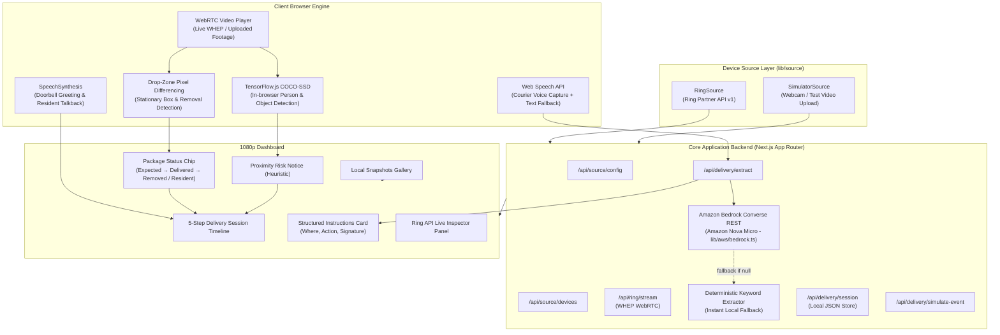

# Smart Delivery Assistant for Ring

[](https://nextjs.org/)
[](https://www.typescriptlang.org/)
[](https://developer.amazon.com/docs/ring/api-documentation.html)
[](https://aws.amazon.com/bedrock/)
[](LICENSE)

> **"Talks to the courier, remembers the delivery instructions, and warns you if someone approaches your package."**

An intelligent doorstep delivery assistant and package watch system built on top of the **Amazon Ring Partner API** and **Amazon Bedrock**. Developed as an entry for the **"Build, Ship, Shape: Amazon Developer Hackathon" (Ring Track)**.

---

### 📺 Demo & Media
- 🎬 **Walkthrough Video**: [Watch the 3-Minute Demo Video](https://youtu.be/your-demo-video-link-here) *(replace with your submission link)*
- 💻 **Live Application Dashboard**: [http://localhost:3000](http://localhost:3000) (or cloud deployment)

---

## 🚀 What’s New vs. the Starter Repo

This project is built upon the official [AmazonAppDev/ring-api-helloworld](https://github.com/AmazonAppDev/ring-api-helloworld) starter template, fundamentally extending it from a raw API connectivity demonstration into a full-featured, intelligent delivery lifecycle application:

| Capability / Component | Upstream Starter (`ring-api-helloworld`) | Smart Delivery Assistant (Our Build) |
|---|---|---|
| **Device Abstraction** | Hardcoded direct calls to Ring Partner API endpoints only. | **`lib/source/` Device Source Layer**: Pluggable interface (`RingSource` vs `SimulatorSource`), allowing seamless switching between live Ring cameras and zero-token offline testing. |
| **Doorbell & Courier Audio** | No audio interaction, TTS, or speech recognition. | **Multimodal Courier Voice Flow**: Automated greeting playback (`SpeechSynthesis`), browser Web Speech API courier voice capture, live subtitle captions, and resident talkback synthesis. |
| **AI Instruction Extraction** | None. | **Amazon Bedrock (Amazon Nova Micro)** integration via lightweight REST API + zero-latency deterministic keyword fallback. Parses drop location, action, signature necessity, and notes. |
| **Drop-Zone Computer Vision** | Stub processor plugins interface only. | **Production Drop-Zone Differencing Engine**: Baseline auto-calibration, edge margin exclusion (ignores timestamps/watermarks), tunable threshold slider, and state machine (`Expected` → `Delivered` → `Removed`). |
| **Person Detection & Proximity Alerting** | None. | **In-Browser COCO-SSD Integration**: Detects person entering drop zone, enforces 10s grace period after delivery, requires 2–3s sustained overlap, and fires compliant *"Possible risk"* notices. |
| **Delivery Verification Flow** | None. | **Automated ~20s Verification Window**: Confirms package presence (`info`) when courier says *"left"*, or generates actionable verification warnings (`warning`) if unconfirmed. |
| **Resident Self-Declaration** | None. | **"🙋 It's me" Action**: Resident dismisses alerts without biometrics or identity tracking, transitioning status to *"Picked up by resident"*. |
| **Session Lifecycle Store** | No session management. | **`lib/store.ts`**: Persistent delivery session state, timeline events with 3 plain-language alert levels, and local canvas snapshot captures. |
| **Scripted Interactive Demo** | None (requires live Ring hardware or active playground stream). | **"🎬 Run Demo Scenario"**: 7-stage end-to-end automated story aligned with synthetic porch footage, runnable on any machine without mic, camera, or tokens. |

---

## 🏗 Architecture



---

## ☁️ AWS Builder Section: Amazon Bedrock & Nova Micro

The assistant integrates **Amazon Bedrock** for zero-touch semantic understanding of informal courier speech:

- **Foundation Model**: `amazon.nova-micro-v1:0` (Amazon Nova Micro) — ultra-fast, cost-effective inference for real-time edge processing.
- **REST Converse Integration** (`lib/aws/bedrock.ts`): Built directly with native `fetch` against `https://bedrock-runtime.{region}.amazonaws.com/model/{modelId}/converse`. Zero AWS SDK bundle bloat.
- **Strict Privacy**:
  - Only anonymous courier transcript text is passed to the Converse API.
  - API credentials (`AWS_BEARER_TOKEN_BEDROCK`) remain strictly server-side and are never sent to the browser or written to logs.
- **Dual-Layer Fallback & Error Resilience**:
  - Request guarded with a strict 7-second abort timeout.
  - If Bedrock is disabled (`LLM_EXTRACTION=off`), unconfigured, or unreachable, the app falls back seamlessly to the local keyword extractor with zero UI disruption.
  - Explicit phrase checks safeguard boolean parsing (e.g., *"no signature needed"* correctly guarantees `needs_signature: false`).

---

## ⚡ Key Features

### 1. Delivery Assistant & Multimodal Voice Flow
- **Automated Doorbell Greeting**: Browser `speechSynthesis` speaks *"Hi! Please leave the package or tell me where you left it."* upon doorbell ding.
- **Voice-to-Text Courier Capture**: Captures speech using the browser's Web Speech API (`SpeechRecognition`) with an immediate typed fallback.
- **Structured Instruction Extraction**: Extracts drop location (e.g. *Behind planter by front door*), action (`left`, `hold`, `handed_over`), signature requirements, and safety notes.
- **Resident Talkback & Live Captions**: Live transcription with bidirectional text-to-speech talkback.

### 2. Package Watch & Drop Zone Differencing
- **Interactive Drop Zone**: User-adjustable bounding box positioned over doorstep steps or porch drop areas.
- **Edge Margin Exclusion**: Frame edges (6–8% margin) are automatically excluded to ignore camera watermarks, timestamps, and device labels.
- **Baseline Calibration**: Automatically calibrates from the first 30 frames (with manual **"Calibrate Baseline"** button and sensitivity threshold slider).
- **Package Status Progression**: Seamless lifecycle tracking (`Expected` &rarr; `Delivered` &rarr; `Removed`).

### 3. Verification & Proximity Alert Logic
- **Delivery Verification (~20s Window)**: When courier instructions indicate `action=left`, an automated timer monitors the drop zone. Confirms package presence (`info`) or flags an actionable alert (`warning`) if unconfirmed.
- **Grace Period**: Ignores people for the first 10 seconds following status `Delivered` to allow couriers to walk away cleanly.
- **Sustained Overlap (2–3 seconds)**: Requires 20+ frames of continuous overlap before alerting.
- **Compliant Wording**: Uses exact phrasing:
  > *"Possible risk: a person approached the package at &lt;time&gt;."*
- **Compliance Disclaimer**:
  > *"Heuristic alert, not proof of intent. No facial recognition or identity tracking."*
- **"🙋 It's me" Self-Declaration**: Residents can declare they retrieved their package, clearing active alerts and updating status to *"Picked up by resident"*. The word *"theft"* is never used.

### 4. Zero-Dependency "Run Demo Scenario"
Clicking **"🎬 Run Demo Scenario"** executes the complete visual timeline:
1. Initializes synthetic porch camera feed.
2. Doorbell chime received & timeline updated.
3. Automated voice greeting spoken aloud.
4. Courier reply captured & structured instructions parsed.
5. Box appears & drop zone confirms delivery (`info`).
6. Person approaches drop zone & proximity notice triggers (`risk`).
7. Package taken & status updates to `Removed` with local canvas snapshot.

---

## 🔌 Ring Partner API Usage

This codebase directly calls the Ring Partner API (`https://api.amazonvision.com/v1`):

| Endpoint | Method | Implementation File | Usage in Project |
|---|:---:|---|---|
| `/v1/devices` | `GET` | [`lib/source/ring-source.ts`](lib/source/ring-source.ts) | Discovers linked Ring doorbells and cameras. |
| `/v1/devices/{id}/status` | `GET` | [`app/api/source/devices/[id]/status/route.ts`](app/api/source/devices/[id]/status/route.ts) | Queries device online connectivity and battery status. |
| `/v1/devices/{id}/capabilities` | `GET` | [`scripts/device_capabilities.py`](scripts/device_capabilities.py) | Python helper script to inspect video codecs, resolutions, and motion zones. |
| `/v1/history/devices/{id}/events` | `GET` | [`app/api/ring/events/history/route.ts`](app/api/ring/events/history/route.ts) | Fetches past motion, ding, and live-view events for the Ring Data Panel. |
| `/v1/devices/{id}/media/streaming/whep/sessions` | `POST` | [`app/api/ring/stream/route.ts`](app/api/ring/stream/route.ts) | Negotiates WHEP SDP offer/answer to establish low-latency WebRTC live stream. |
| `/v1/devices/{id}/media/streaming/whep/sessions/{id}` | `DELETE` | [`app/api/ring/stream/route.ts`](app/api/ring/stream/route.ts) | Closes WHEP streaming session cleanly on stop or timeout. |

---

## 🕹 The Two Source Modes

Set `SOURCE_MODE` in `.env.local` to switch modes:

### 1. `SOURCE_MODE=ring`
- **Badge**: `Ring API (Playground simulated stream)`
- Connects to the real **Ring Partner API** using your Developer Playground access token.
- Displays the **Ring Partner API Data** inspector showing live connected devices, online status, battery level, and recent event history.
- Streams live porch footage via WHEP WebRTC protocol.
- Gracefully handles Playground 30–60 second session limits with a one-click **"Restart Live Stream"** button.

### 2. `SOURCE_MODE=simulator` *(Default)*
- **Badge**: `Simulator (test footage)`
- Fully offline and standalone — no tokens or Ring hardware required.
- Supports **video file upload** (with play/pause/loop controls) to test on custom parcel footage, live webcam, or an animated synthetic porch camera.
- Full `Expected` &rarr; `Delivered` &rarr; `Removed` delivery flow.

---

## ⚠️ Known Limitations & Boundaries

In the spirit of honest technical reporting:
- **Playground Stream Static Footage**: Ring Developer Playground live streams ("Package" and "Motion") loop short pre-recorded video clips. The "Package" stream is a static porch scene with a box already present (no live humans or box removals occur in the stream itself).
- **Dynamic Interaction on Test Footage**: Dynamic person approach and box removal flows are verified and demonstrated via uploaded test footage or the built-in scripted demo scenario.
- **Webhooks**: Live Ring webhooks require an AWS Lambda or publicly-routable HTTPS URL; local development monitors events via polling and local event simulation.
- **Speech Recognition**: The Web Speech API depends on the browser vendor's recognition service (requires Google Chrome or Microsoft Edge and internet access). A typed text fallback is provided for offline or non-mic setups.

---

## 🔒 Privacy, Security & Ethics

- **Local Video Processing**: All computer vision, COCO-SSD object detection, and drop-zone pixel differencing run entirely inside the client's browser. Video streams and snapshots are never uploaded to any third-party cloud server.
- **Audio & Speech**: Audio is processed using the browser's built-in Web Speech API service. Video and snapshots stay strictly local.
- **No Facial Recognition or Identity Tracking**: The system does not perform facial recognition, gender/age estimation, or identity inference.
- **Heuristic Notice**: Bounding box overlap is treated strictly as a geometric proximity heuristic, never as proof of intent or characterization of theft.

---

## 🚀 Getting Started

### 1. Clone & Install

```bash
git clone https://github.com/MuhammedFarhanSyed/Smart-Delivery-Assistant-for-Ring-Amazon-Developer-Hackathon-.git
cd Smart-Delivery-Assistant-for-Ring-Amazon-Developer-Hackathon-
npm install
```

### 2. Environment Configuration

```bash
# Windows:
copy .env.example .env.local

# macOS/Linux:
cp .env.example .env.local
```

Configure `.env.local`:

```env
# Mode 1: Simulator (Default - no token needed)
SOURCE_MODE=simulator

# Mode 2: Ring Partner API
# SOURCE_MODE=ring
# RING_ACCESS_TOKEN=your_token_here
# NEXT_PUBLIC_RING_DEVICE_ID=ava1.ring.device.XXX

# Optional: Amazon Bedrock (Nova Micro)
# LLM_EXTRACTION=on
# AWS_BEARER_TOKEN_BEDROCK=your_bedrock_bearer_token
# AWS_REGION=us-east-1
# BEDROCK_MODEL_ID=amazon.nova-micro-v1:0
```

### 3. Run Development Server

```bash
npm run dev
```

Open [http://localhost:3000](http://localhost:3000) in Google Chrome or Microsoft Edge.

### 4. Build for Production

```bash
npx tsc --noEmit
npm run build
```

---

## 🎬 Testing in 3 Steps

1. Click **"🎬 Run Demo Scenario"** on the top toolbar to watch the full automated workflow (doorbell &rarr; greeting &rarr; courier reply &rarr; structured instructions &rarr; package status &rarr; proximity alert &rarr; removal snapshot).
2. Click **"🔔 Simulate Doorbell"**, listen to the automated greeting, click **"🎤 Listen (Mic)"** (or type in the box), and click **"Process Instructions →"**.
3. In Ring mode, click **"▶ Start Live Stream"** to watch the Ring Playground WHEP video with live drop-zone tracking.

---

## 📚 Attributions & Credits

- Built upon and significantly extended from [AmazonAppDev/ring-api-helloworld](https://github.com/AmazonAppDev/ring-api-helloworld).
- Ring Playground simulated streams are licensed under Creative Commons Attribution 4.0 International ([CC BY 4.0](https://creativecommons.org/licenses/by/4.0/)):
  - *"Thief stealing our package"* by YouTube user **frollard** (Porch & Package stream)
  - *"Birds on Feeders"* by Vimeo user **Michael Black** (Motion stream)
- Object detection powered by [TensorFlow.js COCO-SSD](https://github.com/tensorflow/tfjs-models/tree/master/coco-ssd).

---

## 📄 License

This project is licensed under the [MIT License](LICENSE).
